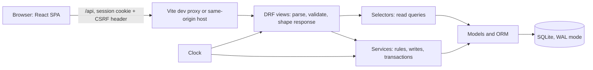
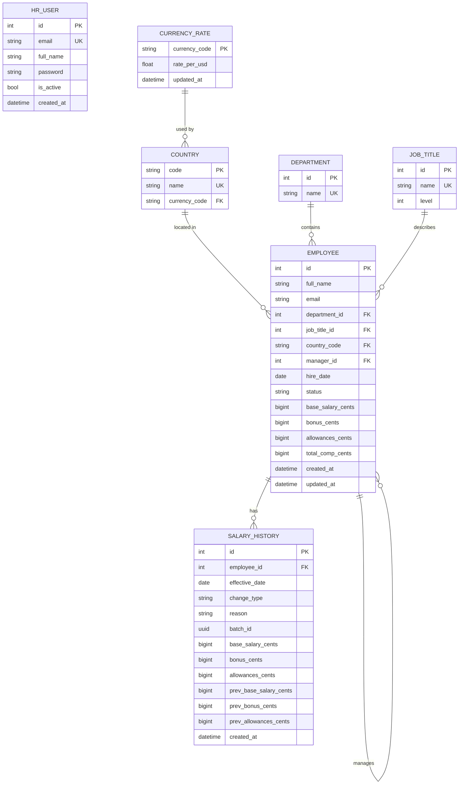
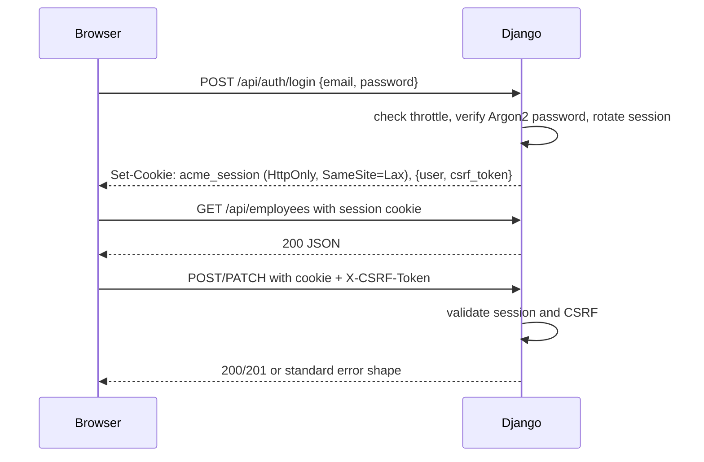

# Software Design: ACME Salary Management

This document describes the software design: architecture, data model, important flows, performance choices and trade-offs. The visual design system is separate: see [`design/DESIGN.md`](../design/DESIGN.md). The product requirements are in [`docs/PRD.md`](PRD.md), and the detailed behaviour is in [`specs/`](../specs/).

## 1. Goals and constraints

The app lets one HR Manager maintain compensation data for about 10,000 employees and answer common pay questions without spreadsheets. The main design constraints are:

- Money must be exact. All amounts are annual USD integer cents, never floats.
- Pay changes must be auditable as history rows, even though the acting user is not recorded.
- Bulk changes must be previewed and applied transactionally.
- Analytics must be meaningful and fast on the seeded 10k dataset.
- Authentication uses Django sessions and CSRF protection; there is no separate token service.
- The backend has no Django admin and no templates. It serves JSON only.
- The frontend is JavaScript with MUI and MUI X DataGrid, not TypeScript.

## 2. Architecture



**Layering rules**

- **Views** are thin. They validate input with serializers, call one service or selector, and serialize the result. They do not run ORM queries.
- **Services** own business rules and write transactions. Examples: employee create/update, hierarchy validation, bulk update, currency-rate changes.
- **Selectors** own read queries and return data shaped for the API. Examples: employee list filters, salary-history search, analytics aggregations.
- **Models** own schema, constraints and indexes. Money is `BigIntegerField`; timestamps are timezone-aware `DateTimeField`.
- **`common/clock.py`** is the only source of "now" and "today" for services and serializers. Tests replace it with a fixed clock.

The browser talks to one origin. In development Vite proxies `/api` to Django on port 8000, so cookies stay first-party and no CORS configuration is needed.

## 3. Data model



Important invariants:

- `employees.total_comp_cents` is a stored generated column: base + bonus + allowances. Application code never writes it.
- Employee emails are unique case-insensitively. Salary history is append-only.
- `salary_history.previous_*` values are null for a hire row and populated for edits and bulk updates.
- Every country points at a currency rate. Deleting a currency used by a country is blocked by the service.
- Employees are never hard-deleted. Deactivation sets `status = inactive`; history is retained.

## 4. Authentication and CSRF



- A custom session authenticator protects all business routes by default.
- Login and health are public. API docs are developer tooling and remain public for local exploration.
- The login response and `GET /api/auth/me` return the CSRF token. The frontend API client adds it to write requests.
- Login failures are throttled per IP and email. The current throttle uses Django's in-process cache; a multi-worker deployment would need a shared cache.
- Session cookies are HttpOnly, SameSite=Lax, and optionally Secure via `COOKIE_SECURE`.
- Every error uses one shape: `{"error": {"code", "message", "details"}}`.

## 5. Important write flows

### Employee create and edit

- Create writes the employee and one `hire` salary-history row in one transaction.
- Edit writes a history row only when a pay component changes. Non-pay edits update the employee without creating history.
- The reason defaults to `Manual edit` when omitted.
- Manager validation rejects unknown or inactive managers, self-reporting and cycles.
- Deactivation is blocked while the employee has active direct reports. Reactivation is blocked while the manager is inactive.

### Bulk update

```mermaid
sequenceDiagram
    participant HR
    participant API
    participant DB
    HR->>API: POST /api/bulk-updates/preview
    API->>DB: aggregate matching employees and new values
    API-->>HR: affected count, sample rows, sums
    HR->>API: POST /api/bulk-updates/apply + expected_count + reason
    API->>DB: BEGIN IMMEDIATE
    API->>DB: re-check count; insert history rows; update employees
    API->>DB: COMMIT
    API-->>HR: affected count, sum delta, batch_id
```

The apply request carries `expected_count`. If the matching set changed between preview and apply, the service raises `stale_preview` and changes nothing. The update expression is calculated in SQL, not by looping in Python. One shared `batch_id` groups the history rows.

### Currency rate changes

- Currency rates are API-only. `GET /api/currency-rates` lists rates with the country codes that use them.
- `POST` creates a rate; `PATCH` changes only `rate_per_usd`; `DELETE` removes an unused non-USD rate.
- USD is the fixed base currency: it cannot be updated or deleted. A rate used by a country cannot be deleted.
- Updating a rate sets `updated_at` from the clock and affects only display-only local amounts. Stored USD values never change.
- Lookups are cached for up to 60 seconds, so a rate change may not appear immediately in the UI.

## 6. Read and analytics flows

- Employee list filtering is built in a selector with a whitelist for sort fields. Search uses `icontains`, which escapes `%` and `_`.
- Salary-history search uses one joined select plus one count query. Inactive employees' history is included.
- Analytics run as SQL aggregations, not per-row Python loops. Inactive employees are excluded by default.
- Distribution bands use fixed boundaries from the analytics spec; values on a boundary go into the higher band.
- Outliers compare an employee's total compensation with peers in the same job title and country.
- The frontend caches queries with TanStack Query and keeps previous page data while a new page loads.

## 7. Performance and indexing

Indexes support the common access paths:

- `(status, country)` and `(status, department)` for filtered employee lists.
- `job_title` and `manager` for filters and direct reports.
- Lowercased `full_name` for name sorting.
- `(employee, -effective_date, -id)` for employee history.
- `(-effective_date, -id)` for the organisation-wide history page.
- A partial index on `batch_id` for batch lookups.

Other choices:

- SQLite runs in WAL mode with `synchronous=NORMAL`.
- List pagination is capped at 100 rows.
- Bulk updates use one aggregate, batched history inserts and one update statement.
- Slow tests run against the full 10k seed and check list, detail and analytics timings.
- The seed disables `synchronous` only for the seed connection, then restores it.

## 8. Frontend design

- `frontend/src/router.jsx` defines public login and protected app routes.
- `AuthProvider` bootstraps the session with `GET /api/auth/me`, stores the CSRF token, and redirects to login on 401.
- `api/client.js` centralizes fetch, JSON parsing, CSRF headers and error mapping.
- Pages use TanStack Query for caching, pagination and invalidation.
- Filters and sorts are URL-synced through `useUrlState` so links are shareable.
- Forms use React Hook Form and Zod; dollars are converted to cents with `lib/money.js` before sending.
- The theme follows [`design/DESIGN.md`](../design/DESIGN.md); shared components include `StatCard`, `StatusChip`, `EmptyState`, `ErrorState` and chart wrappers.

## 9. Trade-offs

These are deliberate, not accidental:

| Decision | Benefit | Cost |
|---|---|---|
| SQLite | Zero setup, simple interview project | Single writer, limited concurrency, no native median/percentile |
| USD-only storage + static FX table | Exact comparisons and analytics | Local amounts are approximate and not live |
| Integer cents | No floating-point drift | Every boundary must convert carefully |
| Append-only history | Pay changes are traceable | No edit/delete; corrections are new rows |
| No actor in history | Simpler model | Cannot show who changed pay |
| One HR user | Simple auth | No roles or permissions yet |
| Direct reports only | Simple, fast team view | No full-subtree rollups |
| API-only currency rates | Keeps HR screens focused | No UI for rate maintenance |
| In-memory login throttle | No extra infrastructure | Not shared across workers |

The PRD's section 6 has the product-level rationale. The specs have the detailed rules.

## 10. How AI was used

AI assisted with code, tests and documentation, but the implementation was driven by the specs and reviewed by hand:

- Work was split into vertical slices. Tests were written before production code, then made green, then refactored. Prompt logs are saved under `prompts/`.
- AI generated a large part of the boilerplate: serializers, selectors, page components, MSW handlers and test scaffolding. Business rules were checked against the specs and covered by deterministic tests.
- AI output was not accepted blindly. Two examples:
  - The first security test approach walked routes dynamically; it was replaced with explicit method/path coverage so missing routes fail loudly.
  - The final documentation review found that the currency-rate API had been specified but not implemented. It was added test-first, with USD and used-currency protection, and the OpenAPI contract was regenerated.
- The UI follows the Stitch visual reference and `design/DESIGN.md`, but was rebuilt with MUI rather than pasting generated HTML/CSS. Deviations are logged in `design/STITCH_HANDOFF.md`.

## 11. Known gaps and future work

- Replace SQLite with Postgres for concurrent writes and native statistical functions.
- Move login throttling to a shared cache such as Redis.
- Add audit fields for the acting HR user.
- Add roles and multiple HR users.
- Add a currency-rate screen if HR needs to maintain rates directly.
- Add import/export and scheduled FX rate updates if the product needs them.
- Add a production deployment setup: WSGI server, HTTPS, static hosting, backups and health monitoring.
